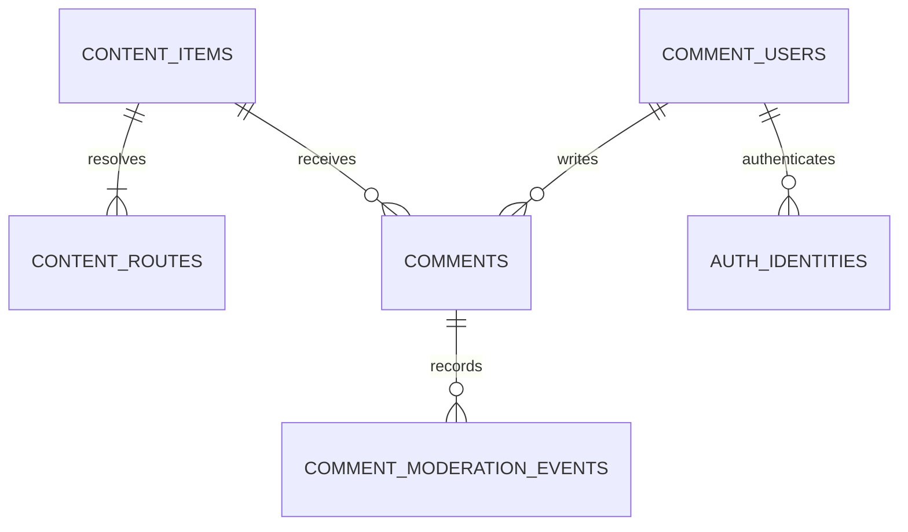
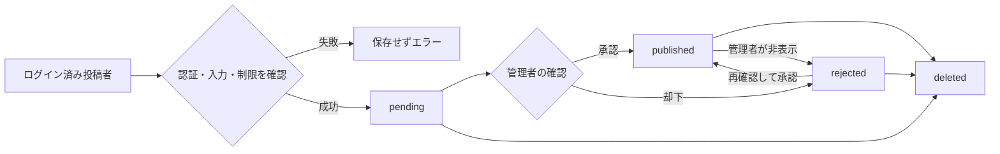

# OrifolioのコメントDB設計案

- [要点](#要点)
- [現行データと対象](#現行データと対象)
- [データと権限](#データと権限)
- [コンテンツID](#コンテンツid)
- [投稿と公開](#投稿と公開)
- [APIとページング](#apiとページング)
- [スパムと個人情報](#スパムと個人情報)
- [導入手順と受入条件](#導入手順と受入条件)
- [未決事項](#未決事項)
- [参考リンク](#参考リンク)

## 要点

- 本文の正本は既存のGit管理MDXに残す。
- コメントと投稿者情報だけをPostgreSQLへ保存する案とする。
- 読む人はログイン不要、投稿は検証済みセッション必須とする。
- 新規投稿は承認待ちとし、管理者の承認後に公開する。
- URLやファイル名の変更から独立したUUIDをコメントの参照先にする。
- DB契約、OAuthアプリ作成、DBへのDDL適用、コメント機能の公開は未実施である。

PostgreSQLと以下の仕様は設計上の提案であり、サービス・認証方式の採用決定ではない。
Vercelは配信とAPIの実行先である。
Vercelへの移行だけではコメントを永続化するDBは用意されない。

## 現行データと対象

現在の記事とノートのslugは、各ディレクトリからの相対パスである。
本はファイル名、シリーズは `lib/series-books.ts` のslugを使う。
`notes.related_article_ids` も現時点では記事slugであり、不変のDB主キーではない。

| 種類 | 現行例 | 初期のコメント対象 |
| --- | --- | --- |
| 記事 | `articles/architecture/auth/authentication-types.mdx` | 公開済み記事 |
| 本 | `books/database-internal.mdx` | 本全体。章単位は後で検討 |
| ノート | `notes/aws/lambda-permission-checklist.mdx` | 公開済みノート |
| シリーズ | `world-file-extensions` | IDは登録可能。初期投稿は無効を提案 |

初期機能は本文のみのコメント、承認、自分のコメントの削除までとする。
返信ツリー、画像添付、リアクション、通知メール、投稿後編集は初期範囲に含めない。
編集を追加する場合は、再承認と同時更新制御を別途定義する。

## データと権限



| テーブル | 主な項目・制約 | 用途 |
| --- | --- | --- |
| `content_items` | `id uuid PK`、`kind`、`visibility`、`comments_enabled`、日時 | 本文を持たないコメントの参照先 |
| `content_routes` | `kind`、`slug`、`content_id FK`、`is_current` | 現行と旧slugを同じIDへ解決 |
| `comment_users` | `id uuid PK`、`display_name`、`role`、`state`、日時 | 表示名、投稿可否、管理権限 |
| `auth_identities` | `user_id FK`、`issuer`、`subject`、`UNIQUE(issuer, subject)` | 認証ライブラリが検証した本人との対応。非公開 |
| `comments` | `id uuid PK`、`content_id FK`、`author_id FK`、`body`、`status`、日時、`request_key` | コメント本文と状態 |
| `comment_moderation_events` | `id`、`comment_id FK`、`actor_id FK`、`action`、`from_status`、`to_status`、`reason_code`、日時 | 承認・非表示・削除の監査。本文は複製しない |

`kind` は `article / book / note / series` とする。
`visibility` は `public / retired` とし、未公開原稿そのものはDBへ同期しない。
`role` は `member / moderator`、`state` は `active / blocked / deleted` とする。
管理権限はサーバー管理操作でのみ付与し、クライアントの申告を受け入れない。

認証関連の実テーブルは採用する認証ライブラリのadapter仕様に合わせる。
上表の `auth_identities` は必要な一意性と非公開境界を示す論理モデルである。
同じメールアドレスという理由だけで、別providerのアカウントを自動統合しない。
セッションの発行・失効を独自実装せず、保守されているライブラリを使う。

| 操作 | 未ログイン | 本人 | moderator |
| --- | --- | --- | --- |
| 公開コメントの閲覧 | 可 | 可 | 可 |
| 投稿 | 不可 | activeかつ対象が公開・受付中なら可 | 同じ投稿条件 |
| 承認待ち・却下の閲覧 | 不可 | 自分の分のみ | 可 |
| 承認・却下 | 不可 | 不可 | 可 |
| 削除 | 不可 | 自分の分のみ | 可 |
| 個人情報・認証情報の取得 | 不可 | 公開APIからは不可 | 公開APIからは不可 |

DBへはサーバーだけが接続する。
ブラウザへDB認証情報や管理用キーを渡さない。
環境変数名に `NEXT_PUBLIC_` を付けない。
DB提供元でRLSを使う場合も、APIの本人・権限確認を省略しない。

## コンテンツID

1. コメント導入時に、公開コンテンツとシリーズにUUIDを一度だけ割り当てる。
2. Git管理するレジストリに `id / kind / current_slug` を保存する。
3. 公開ビルドと照合したレジストリを、管理用同期処理でDBへupsertする。
4. slug変更時はUUIDを保持し、旧routeを残して新しいrouteを現行にする。
5. 非公開化・削除時は `visibility=retired` とし、コメントを公開一覧からも外す。

ドメイン・`/tech-note`・タイトル・更新日時・本文ハッシュはIDの材料にしない。
同じ内容の別記事も別IDとして扱う。
一度退役したIDやslugを別の本文へ使い回さない。
旧slugでの本文転送は、レジストリだけでは実装されないためNext.jsの転送も追加する。

必要な制約は次のとおりである。

- `UNIQUE(kind, slug)` により同じrouteを複数の本文へ割り当てない。
- `UNIQUE(content_id) WHERE is_current` により現行routeを一つにする。
- routeと本文のkind一致は複合FKまたは同等のDB制約で保証する。
- 同期処理はIDやコメントを削除しない。
  公開一覧から外れた対象は明示的にretiredにする。
- 投稿APIは任意のUUIDを受けても、公開・受付中の実在対象にしか書き込まない。
- 旧Previewからの同期で本番visibilityを戻さないよう、同期を本番の確定リリースへ限定する。

## 投稿と公開

1. 認証ライブラリでセッションの有効性とサーバー側のユーザーIDを取得する。
2. Origin/CSRF、アカウント状態、対象の公開状態、投稿制限を確認する。
3. 本文を検証し、`pending` で保存する。
4. moderatorが管理画面で内容を確認し、公開または却下する。
5. 公開一覧には `published` と公開中の対象だけを返す。



| 状態 | 公開一覧 | 更新できる主体 |
| --- | --- | --- |
| `pending` | 含めない | moderatorの承認・却下、本人またはmoderatorの削除 |
| `published` | 含める | moderatorの非表示、本人またはmoderatorの削除 |
| `rejected` | 含めない | moderatorの再承認、本人またはmoderatorの削除 |
| `deleted` | 含めない | 復元しない。本文をNULLにする |

承認・却下・削除と監査イベントは一つのtransactionで保存する。
`UPDATE ... WHERE id=? AND status=?` または行ロックを使い、競合時は409を返す。
削除済みコメントへの同じ削除要求は204でよい。
削除後の再承認は禁止する。

`comments.body` はtrim後1〜2,000 Unicodeコードポイント、リクエスト全体は16 KiB以下を初期値として提案する。
NULと不要な制御文字を拒否する。
DBにも長さと状態のCHECK制約を置き、`deleted` のときだけ本文NULLを許可する。
SQLはパラメーター化し、本文をSQLへ連結しない。

公開表示はReactのテキストノードを使い、改行だけをCSSで保持する。
コメントをMDXとしてcompileしない。
HTML、Markdown、埋め込み、URLの自動リンクは初期範囲では扱わない。
`dangerouslySetInnerHTML` を使用しない。

## APIとページング

以下は実装前のAPI案であり、現在は存在しない。
全パスに既存の `/tech-note` を付ける。

| メソッドとパス | 結果 |
| --- | --- |
| `GET /api/content/:id/comments?cursor=...&limit=20` | 公開対象の公開コメントだけを返す |
| `POST /api/content/:id/comments` | 本人をセッションから決め、承認待ちで保存 |
| `GET /api/me/comments` | 自分の公開・承認待ち・却下を返す。private/no-store |
| `DELETE /api/comments/:id` | 所有者またはmoderatorが削除 |
| `POST /api/moderation/comments/:id/decision` | moderatorのみ承認・却下 |

- 公開DTOは `id / body / author.display_name / created_at / published_at` に限定する。
- メール、provider subject、role、IP、審査理由、セッション情報は返さない。
- `author_id`、`status`、`role`、`published_at` を投稿bodyから受け入れない。
- `request_key` は投稿時のクライアント生成UUIDとし、`UNIQUE(author_id, request_key)` で再送を一件にする。
  同じキー・同じ対象と本文なら同じ結果を返し、異なる内容なら409とする。
- `401 / 403 / 404 / 409 / 422 / 429` を条件別に返す。
  未公開対象の存在や他人の非公開コメントの内容をエラーに含めない。
- 初期はコメントAPIを `Cache-Control: private, no-store` とする。
  公開本文の静的キャッシュと、承認・削除が反映されるコメント取得を分ける。

ページングは `published_at ASC, id ASC` のキーセット方式とする。
承認待ちが後から公開されても途中へ割り込まないよう、初回承認時に `published_at` を固定する。
再承認時も値を変えない。
cursorは型と長さを検証し、対象content_idと並び順を固定する。
limitの既定は20、上限は50とする。

```sql
-- 説明用。DB契約・migration適用は未実施。
CREATE INDEX comments_public_page
  ON comments (content_id, published_at, id)
  WHERE status = 'published';

CREATE INDEX comments_moderation_queue
  ON comments (created_at, id)
  WHERE status = 'pending';

-- content_itemsとのJOINで visibility='public' も確認する。
SELECT c.id, c.body, u.display_name, c.created_at, c.published_at
FROM comments c
JOIN content_items i ON i.id = c.content_id
JOIN comment_users u ON u.id = c.author_id
WHERE c.content_id = $1
  AND i.visibility = 'public'
  AND c.status = 'published'
  AND (c.published_at, c.id) > ($2, $3)
ORDER BY c.published_at, c.id
LIMIT $4;
```

先頭ページではcursor条件を付けない。
件数はlimit+1件取得して次cursorの有無を判定する。
deleted/rejectedは公開件数にも含めない。

## スパムと個人情報

| 項目 | 初期案 |
| --- | --- |
| 投稿者認証 | 技術読者向けのGitHub OAuthを候補とする。方式は未決定 |
| セッション | Secure / HttpOnly / SameSite Cookie、有効期限、サーバー側失効 |
| CSRF | 採用ライブラリのCSRF保護に加え、変更APIのOriginとJSON Content-Typeを検証 |
| 連投 | ユーザー単位で1分3件・1日20件、ネットワーク単位で1分10件を提案 |
| 制限の保存先 | DBの時刻bucketとatomic upsert、または既存の共有ストア |
| IP | レート制限用HMACのみ。生IPをコメントDBへ保存しない |
| 制限データの寿命 | 48時間で失効・削除。HMAC鍵も期間で更新 |
| bot対策 | 認証・全件承認・連投制限から開始。CAPTCHAは必要性と契約を別途判断 |
| 監査 | 操作と状態、理由コードのみ。コメント本文やメールを複製しない |
| ログ | request ID、状態、エラーコードを記録。本文・Cookie・トークンを記録しない |

サーバーレスのプロセスメモリやlocalStorageだけで投稿制限を実装しない。
trusted proxy由来のIPだけを使い、クライアント申告の転送ヘッダーを無条件に信用しない。
HMAC値も管理情報として公開しない。
複数インスタンスと並行要求でも制限が維持されることを検証する。

表示名は公開されることを投稿前に案内する。
メールは認証上必要な場合だけprivate領域に保存し、本人同意なく公開しない。
OAuthでGitHub repoの読取・書込権限を要求しない。
投稿用途に不要なaccess token/refresh tokenを長期保存しない。
権限と保持項目は採用ライブラリの実際の仕様で再確認する。

本人削除では本文を消し、アカウント削除時は認証識別子と表示名を消去して「削除済みユーザー」とする。
コメントも一括削除するか匿名化して残すかは公開前の判断とする。
却下・承認待ち本文の保持期限、DBバックアップの保持期限、監査期限を決め、プライバシー案内へ反映する。
ログやバックアップからの消去時差も明記する。

## 導入手順と受入条件

1. DB提供元、費用上限、リージョン、認証方式、保持期限を本人が決める。
2. 接続・認可が揃った後、別の検証DBでschemaと認証adapterを実装する。
3. 公開コンテンツIDを固定し、二回同期してもIDと件数が変わらないことを検証する。
4. 投稿・承認・削除・認可とレート制限を実装する。
5. 独立テストで下記の条件を確認してから一般公開を判断する。

| 確認 | 合格条件 |
| --- | --- |
| 公開境界 | 下書き・retired対象と承認待ち・却下・削除済み本文が公開APIに出ない |
| 本人認証 | 匿名、期限切れ、改ざんセッションで書き込めない |
| 所有者認可 | 他人の削除・自己承認・role変更が拒否される |
| XSS | `<script>`、イベント属性、MDX風入力が実行されず文字として表示される |
| 安定ID | ドメイン・slug変更後も同じコメントが残る。旧slugの対応も維持される |
| 再送・競合 | 同じrequest_keyで一件だけ保存。削除と承認の競合で復活しない |
| ページング | 同時承認・同時刻・削除があっても順序とcursor境界が壊れない |
| スパム制限 | 並列要求・複数インスタンス・再試行でも制限が抜けない |
| 個人情報 | 公開JSON、HTML、ログ、エラーにメール・IP・トークンが出ない |
| 障害 | DB障害でも記事本文が読め、送信失敗を成功として表示しない |
| 移行と復元 | backupから検証環境へ復元でき、旧サイト本文・画像の欠落がない |

## 未決事項

| 判断 | 決めれば進められること |
| --- | --- |
| PostgreSQL提供元・費用上限・データ所在 | 新サービス契約と接続方式 |
| GitHub OAuthを採るか、別方式にするか | 認証library、callback URL、必要な新資格情報 |
| 本・ノートも初回から対象にするか | 表示位置と対象registry |
| 承認担当と対応頻度 | 管理画面と運用の受入条件 |
| コメント削除・退会・未承認データの保持期限 | privacy表示、purge、backup運用 |
| 正規の公開ホスト | 本番OAuth callback、Cookie、CSRF許可Origin |

現時点では新しいDB契約やOAuth資格情報を作らない。
認可の追加、料金発生、規約同意が必要な段階で、具体的なサービスと条件を確認する。

## 参考リンク

- 開発手順: [リポジトリREADME](../../README.md)
- 移行手順: [Vercel移行](../vercel-migration/README.md)
- 現行仕様: [記事取得](../../lib/articles.ts)、[本取得](../../lib/books.ts)、[ノート取得](../../lib/notes.ts)
- 設計上の参考: [PostgreSQLの制約](https://www.postgresql.org/docs/current/ddl-constraints.html)
- 設計上の参考: [OWASPの認可](https://cheatsheetseries.owasp.org/cheatsheets/Authorization_Cheat_Sheet.html)
- 設計上の参考: [OWASPのXSS防止](https://cheatsheetseries.owasp.org/cheatsheets/Cross_Site_Scripting_Prevention_Cheat_Sheet.html)
